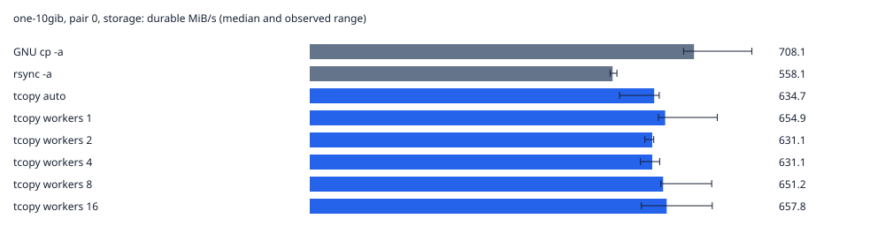
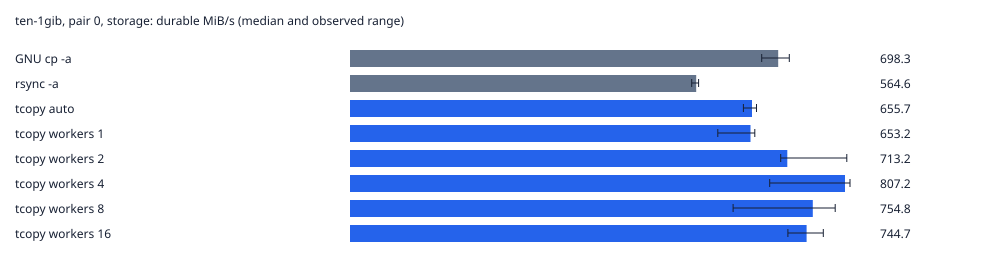
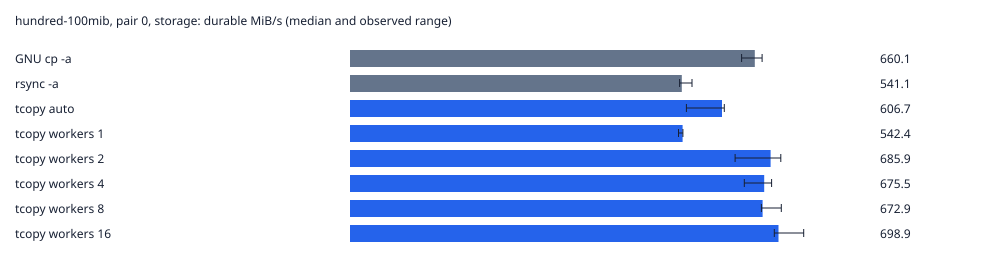
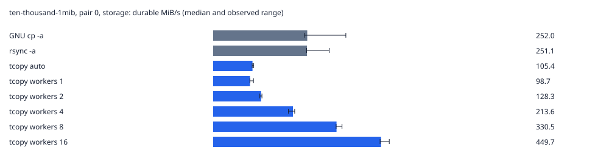

# TurboCopy Phase 5: large datasets and parallel throughput

Status: **completed**. 

Recorded 2026-10-12T02:23:18.031454+00:00; source revision `e0fbd04bc7718797dd06db3fc2f4c31b0504aabf`.

Verified 96 dense copies and 96 empty-file companion copies. The copy engine was unchanged.

## Storage and safety

Inventory, commands, binary hash, individual samples and cache checks are in [benchmark-phase5.json](benchmark-phase5.json). Only owned temporary trees are removed. No storage configuration or global caches are changed. One source and one destination are retained at a time. Free-space reserves, free inodes, available RAM and PSI are checked before and during execution; failures stop the benchmark and retain results.

| Parent | Filesystem / mount | Physical storage | Initial free GiB |
| --- | --- | --- | ---: |
| `/home/ewave/projects/turboCopy` | btrfs / `/home/ewave/projects/turboCopy` | nvme0n1 (HFM001TD3JX013N) | 545.50 |

Free space must exceed the dataset working set plus the larger of 20 GiB and 10% of filesystem capacity. The guard stops below 512 MiB available RAM, or after 10 seconds with I/O full PSI avg10 ≥50% or memory full PSI avg10 ≥10%. Existing compression options remain in place; dense random data avoids a compression advantage. Mount options and Btrfs allocation estimates are retained in JSON.

Cross-device storage benchmark unsupported: no independent writable mounted physical-device pair was selected. tmpfs is not physical storage.

## Method

Defaults: 1 × 10 GiB, 10 × 1 GiB, 100 × 100 MiB (9.765625 GiB), 10,000 × 1 MiB (9.765625 GiB). Fresh OS random bytes are written throughout each file, with no repeated blocks or sparse seeks; allocation and sampled zlib ratios are checked. Sources use identical modes, ownership and nanosecond mtimes, with no intentional ACLs, hard links or user xattrs. Every destination is new. SHA-256, file set, size, mode, uid/gid and mtime are verified outside the measured interval. Atime/ctime and security labels are outside the shared preservation contract; rsync -a and existing default TurboCopy do not preserve all of those fields.

GNU `cp -a --reflink=never --sparse=never`, `rsync -a`, `tcopy --auto`, and `tcopy --workers N` for N = 1, 2, 4, 8, 16 are compared. TurboCopy also emits JSON. Order is shuffled with a recorded seed for each of at least three iterations. No reflink, sparse, resume, incremental or explicit chunk options are enabled.

The common durability endpoint is tool completion plus fsync of every destination file and directory, including the containing directory. Total time and throughput include this final barrier, whose time is also recorded separately. TurboCopy's existing per-file sync and atomic publication remain included in its tool time; intermediate failure guarantees are stronger and cannot be equalized without changing the engine. Final metadata and durability requirements are identical. The common final tree fsync is serial, so tools that already flushed in parallel can spend less time in that barrier; copy-only time is reported separately.

Storage runs request POSIX_FADV_DONTNEED on clean source files and require ≤1% source-page residency via mincore immediately before copying. Warm runs read the entire source and require ≥99% residency. Warm runs that cannot fit within half the currently available memory are skipped. Uncontrolled samples never enter the comparison. Metadata, controller/device caches, CPU frequency, SSD temperature, compression mount options and other host activity remain uncontrolled. Storage runs measure verified source page-cache eviction, not a fully cold device.

wait4 captures tool/descendant CPU time; CPU percent uses one core = 100%. A dedicated supervisor reads `/proc/self/io` after waiting for the tool, including waited descendants and a small amount of supervisor I/O. These are process-attributed storage bytes and logical syscall counters, not exact physical traffic; delayed writeback and metadata accounting can differ. Physical device sector deltas cover tool execution plus final sync and include other host I/O. Verification and source preparation are excluded. Empty-file companion copies measure creation/metadata/sync overhead separately; their cache is explicitly uncontrolled and they are not subtracted from dense-copy times. TurboCopy's metadata/transfer timers are sums across concurrent workers, not wall time.

## Measured throughput

Only verified, controlled groups with all requested iterations are graphed. Bars are median durable MiB/s; whiskers are observed min–max across iterations. Workload graphs share a scale within each pair/cache condition. All raw I/O/CPU metrics are in JSON.









| Pair | Workload | Cache | Tool | n | Durable MiB/s | Copy s | Total s | Final sync s | CPU % |
| --- | --- | --- | --- | ---: | ---: | ---: | ---: | ---: | ---: |
| 0 | one-10gib | storage | GNU cp -a | 3 | 708.1 | 13.689 | 14.462 | 0.773 | 77.3 |
| 0 | one-10gib | storage | rsync -a | 3 | 558.1 | 17.838 | 18.348 | 0.510 | 112.4 |
| 0 | one-10gib | storage | tcopy auto | 3 | 634.7 | 16.125 | 16.132 | 0.007 | 64.0 |
| 0 | one-10gib | storage | tcopy workers 1 | 3 | 654.9 | 15.628 | 15.635 | 0.008 | 66.7 |
| 0 | one-10gib | storage | tcopy workers 2 | 3 | 631.1 | 16.217 | 16.224 | 0.007 | 63.3 |
| 0 | one-10gib | storage | tcopy workers 4 | 3 | 631.1 | 16.219 | 16.227 | 0.008 | 63.9 |
| 0 | one-10gib | storage | tcopy workers 8 | 3 | 651.2 | 15.716 | 15.724 | 0.008 | 66.9 |
| 0 | one-10gib | storage | tcopy workers 16 | 3 | 657.8 | 15.561 | 15.568 | 0.007 | 72.8 |
| 0 | ten-1gib | storage | GNU cp -a | 3 | 698.3 | 13.831 | 14.665 | 0.833 | 74.4 |
| 0 | ten-1gib | storage | rsync -a | 3 | 564.6 | 17.604 | 18.138 | 0.534 | 110.3 |
| 0 | ten-1gib | storage | tcopy auto | 3 | 655.7 | 15.600 | 15.618 | 0.018 | 82.7 |
| 0 | ten-1gib | storage | tcopy workers 1 | 3 | 653.2 | 15.668 | 15.676 | 0.016 | 70.3 |
| 0 | ten-1gib | storage | tcopy workers 2 | 3 | 713.2 | 14.297 | 14.357 | 0.012 | 88.7 |
| 0 | ten-1gib | storage | tcopy workers 4 | 3 | 807.2 | 12.642 | 12.685 | 0.026 | 115.7 |
| 0 | ten-1gib | storage | tcopy workers 8 | 3 | 754.8 | 13.528 | 13.566 | 0.045 | 106.1 |
| 0 | ten-1gib | storage | tcopy workers 16 | 3 | 744.7 | 13.704 | 13.750 | 0.045 | 110.0 |
| 0 | hundred-100mib | storage | GNU cp -a | 3 | 660.1 | 14.355 | 15.149 | 0.847 | 63.4 |
| 0 | hundred-100mib | storage | rsync -a | 3 | 541.1 | 17.682 | 18.481 | 0.646 | 103.4 |
| 0 | hundred-100mib | storage | tcopy auto | 3 | 606.7 | 16.469 | 16.484 | 0.381 | 86.7 |
| 0 | hundred-100mib | storage | tcopy workers 1 | 3 | 542.4 | 18.055 | 18.437 | 0.382 | 67.3 |
| 0 | hundred-100mib | storage | tcopy workers 2 | 3 | 685.9 | 14.221 | 14.579 | 0.358 | 101.9 |
| 0 | hundred-100mib | storage | tcopy workers 4 | 3 | 675.5 | 14.528 | 14.805 | 0.382 | 132.1 |
| 0 | hundred-100mib | storage | tcopy workers 8 | 3 | 672.9 | 14.505 | 14.862 | 0.357 | 120.2 |
| 0 | hundred-100mib | storage | tcopy workers 16 | 3 | 698.9 | 13.916 | 14.308 | 0.392 | 123.5 |
| 0 | ten-thousand-1mib | storage | GNU cp -a | 3 | 252.0 | 22.188 | 39.686 | 17.751 | 42.6 |
| 0 | ten-thousand-1mib | storage | rsync -a | 3 | 251.1 | 25.471 | 39.825 | 14.425 | 70.6 |
| 0 | ten-thousand-1mib | storage | tcopy auto | 3 | 105.4 | 93.825 | 94.902 | 0.996 | 18.2 |
| 0 | ten-thousand-1mib | storage | tcopy workers 1 | 3 | 98.7 | 100.037 | 101.304 | 1.272 | 17.4 |
| 0 | ten-thousand-1mib | storage | tcopy workers 2 | 3 | 128.3 | 76.679 | 77.940 | 1.241 | 24.5 |
| 0 | ten-thousand-1mib | storage | tcopy workers 4 | 3 | 213.6 | 45.556 | 46.813 | 1.257 | 49.0 |
| 0 | ten-thousand-1mib | storage | tcopy workers 8 | 3 | 330.5 | 28.986 | 30.261 | 1.275 | 86.4 |
| 0 | ten-thousand-1mib | storage | tcopy workers 16 | 3 | 449.7 | 20.936 | 22.238 | 1.317 | 140.4 |

## Parallelism analysis

- Pair 0, one-10gib, storage: best parallel setting is **tcopy workers 16**, 1.00× workers 1. Observed ranges overlap or parallelism is slower; no clear gain beyond noise.
- Pair 0, ten-1gib, storage: best parallel setting is **tcopy workers 4**, 1.24× workers 1. Its entire observed range exceeds workers 1.
- Pair 0, hundred-100mib, storage: best parallel setting is **tcopy workers 16**, 1.29× workers 1. Its entire observed range exceeds workers 1.
- Pair 0, ten-thousand-1mib, storage: best parallel setting is **tcopy workers 16**, 4.56× workers 1. Its entire observed range exceeds workers 1.

One dense file exposes no file-level parallelism in manual worker mode without chunks. More files can occupy more workers; additional workers can also increase same-device contention and per-file fsync costs. Treat these as explanations to check against recorded worker/chunk telemetry, not performance claims for untested storage.

Observed automatic-mode initial → final worker limits: **4 → 1** across 12 verified dense copies. These reflect the existing pressure policy. Prior verification and preparation I/O can influence its recent pressure window. Manual workers retain their limits. The 10,000-file runs spend most of their summed worker time in metadata/sync work, so overlapping those waits produces the largest measured parallel gain. Observed ranges are not confidence intervals.

## Read/write accounting

Medians in GiB. Device totals cover all backing devices and include other host activity; process totals cover the tool and supervisor, ending before the final external fsync.

| Pair/cache | Workload | Tool | Process read GiB | Process write GiB | Device read GiB | Device write GiB |
| --- | --- | --- | ---: | ---: | ---: | ---: |
| 0/storage | one-10gib | GNU cp -a | 10.018 | 10.000 | 10.026 | 10.035 |
| 0/storage | one-10gib | rsync -a | 10.000 | 10.000 | 10.012 | 10.039 |
| 0/storage | one-10gib | tcopy auto | 10.000 | 10.009 | 10.002 | 10.038 |
| 0/storage | one-10gib | tcopy workers 1 | 10.000 | 10.008 | 10.010 | 10.033 |
| 0/storage | one-10gib | tcopy workers 2 | 10.000 | 10.007 | 10.018 | 10.044 |
| 0/storage | one-10gib | tcopy workers 4 | 10.004 | 10.009 | 10.005 | 10.038 |
| 0/storage | one-10gib | tcopy workers 8 | 10.000 | 10.005 | 10.001 | 10.041 |
| 0/storage | one-10gib | tcopy workers 16 | 10.000 | 10.005 | 10.009 | 10.045 |
| 0/storage | ten-1gib | GNU cp -a | 10.000 | 10.000 | 10.002 | 10.043 |
| 0/storage | ten-1gib | rsync -a | 10.000 | 10.000 | 10.008 | 10.040 |
| 0/storage | ten-1gib | tcopy auto | 10.000 | 10.015 | 10.003 | 10.058 |
| 0/storage | ten-1gib | tcopy workers 1 | 10.000 | 10.011 | 10.002 | 10.036 |
| 0/storage | ten-1gib | tcopy workers 2 | 10.000 | 10.014 | 10.005 | 10.053 |
| 0/storage | ten-1gib | tcopy workers 4 | 10.000 | 10.014 | 10.014 | 10.051 |
| 0/storage | ten-1gib | tcopy workers 8 | 10.000 | 10.014 | 10.001 | 10.039 |
| 0/storage | ten-1gib | tcopy workers 16 | 10.000 | 10.015 | 10.018 | 10.051 |
| 0/storage | hundred-100mib | GNU cp -a | 9.766 | 9.766 | 9.779 | 9.803 |
| 0/storage | hundred-100mib | rsync -a | 9.766 | 9.766 | 9.768 | 9.816 |
| 0/storage | hundred-100mib | tcopy auto | 9.766 | 9.789 | 9.768 | 9.839 |
| 0/storage | hundred-100mib | tcopy workers 1 | 9.766 | 9.791 | 9.766 | 9.841 |
| 0/storage | hundred-100mib | tcopy workers 2 | 9.766 | 9.792 | 9.769 | 9.850 |
| 0/storage | hundred-100mib | tcopy workers 4 | 9.766 | 9.784 | 9.767 | 9.828 |
| 0/storage | hundred-100mib | tcopy workers 8 | 9.766 | 9.784 | 9.766 | 9.832 |
| 0/storage | hundred-100mib | tcopy workers 16 | 9.798 | 9.784 | 9.800 | 9.827 |
| 0/storage | ten-thousand-1mib | GNU cp -a | 9.768 | 9.770 | 9.771 | 10.473 |
| 0/storage | ten-thousand-1mib | rsync -a | 9.766 | 9.771 | 9.773 | 10.355 |
| 0/storage | ten-thousand-1mib | tcopy auto | 9.766 | 11.272 | 9.793 | 12.902 |
| 0/storage | ten-thousand-1mib | tcopy workers 1 | 9.766 | 11.440 | 9.789 | 13.235 |
| 0/storage | ten-thousand-1mib | tcopy workers 2 | 9.766 | 11.258 | 9.787 | 12.876 |
| 0/storage | ten-thousand-1mib | tcopy workers 4 | 9.766 | 10.733 | 9.780 | 11.762 |
| 0/storage | ten-thousand-1mib | tcopy workers 8 | 9.766 | 10.316 | 9.767 | 10.924 |
| 0/storage | ten-thousand-1mib | tcopy workers 16 | 9.766 | 10.102 | 9.775 | 10.478 |

## Creation and metadata overhead

| Pair | Workload | Tool | Median empty-tree s | Files/s | Final sync s |
| --- | --- | --- | ---: | ---: | ---: |
| 0 | one-10gib | GNU cp -a | 0.012 | 81.2 | 0.011 |
| 0 | one-10gib | tcopy workers 16 | 0.028 | 35.5 | 0.011 |
| 0 | one-10gib | tcopy workers 8 | 0.028 | 36.2 | 0.011 |
| 0 | one-10gib | tcopy workers 2 | 0.028 | 36.3 | 0.011 |
| 0 | one-10gib | tcopy auto | 0.027 | 36.4 | 0.011 |
| 0 | one-10gib | tcopy workers 1 | 0.027 | 36.4 | 0.011 |
| 0 | one-10gib | rsync -a | 0.057 | 17.7 | 0.011 |
| 0 | one-10gib | tcopy workers 4 | 0.028 | 36.3 | 0.011 |
| 0 | ten-1gib | tcopy workers 1 | 0.129 | 77.8 | 0.045 |
| 0 | ten-1gib | rsync -a | 0.088 | 113.2 | 0.043 |
| 0 | ten-1gib | tcopy workers 16 | 0.067 | 148.9 | 0.043 |
| 0 | ten-1gib | tcopy workers 4 | 0.092 | 108.7 | 0.043 |
| 0 | ten-1gib | tcopy workers 2 | 0.122 | 82.2 | 0.044 |
| 0 | ten-1gib | GNU cp -a | 0.045 | 223.7 | 0.043 |
| 0 | ten-1gib | tcopy workers 8 | 0.079 | 127.1 | 0.043 |
| 0 | ten-1gib | tcopy auto | 0.117 | 85.7 | 0.043 |
| 0 | hundred-100mib | tcopy workers 16 | 0.485 | 206.2 | 0.374 |
| 0 | hundred-100mib | tcopy workers 1 | 1.121 | 89.2 | 0.373 |
| 0 | hundred-100mib | rsync -a | 0.425 | 235.3 | 0.376 |
| 0 | hundred-100mib | tcopy auto | 0.741 | 135.0 | 0.376 |
| 0 | hundred-100mib | GNU cp -a | 0.401 | 249.3 | 0.394 |
| 0 | hundred-100mib | tcopy workers 4 | 0.740 | 135.2 | 0.374 |
| 0 | hundred-100mib | tcopy workers 2 | 1.074 | 93.1 | 0.394 |
| 0 | hundred-100mib | tcopy workers 8 | 0.574 | 174.3 | 0.373 |
| 0 | ten-thousand-1mib | rsync -a | 13.859 | 721.5 | 13.330 |
| 0 | ten-thousand-1mib | tcopy workers 8 | 9.955 | 1004.5 | 5.279 |
| 0 | ten-thousand-1mib | tcopy workers 4 | 29.485 | 339.2 | 8.175 |
| 0 | ten-thousand-1mib | tcopy workers 1 | 59.499 | 168.1 | 1.258 |
| 0 | ten-thousand-1mib | tcopy workers 2 | 46.623 | 214.5 | 0.415 |
| 0 | ten-thousand-1mib | tcopy workers 16 | 21.690 | 461.0 | 12.006 |
| 0 | ten-thousand-1mib | GNU cp -a | 7.086 | 1411.3 | 6.586 |
| 0 | ten-thousand-1mib | tcopy auto | 50.379 | 198.5 | 1.680 |

Source generation, file creation, metadata setup and sync times are recorded separately in `datasets`; generation time includes randomness and pressure checks. Creation measures file open only; these setup timers do not include every setup operation.

## Unsupported and uncontrolled conditions

- pair 0, one-10gib: warm cache unsupported; source exceeds half available RAM
- pair 0, ten-1gib: warm cache unsupported; source exceeds half available RAM
- pair 0, hundred-100mib: warm cache unsupported; source exceeds half available RAM
- pair 0, ten-thousand-1mib: warm cache unsupported; source exceeds half available RAM
- Detailed Btrfs per-device allocation is unavailable: mapped /dev nodes are hidden in this execution namespace. The userspace MISSING text reflects that visibility limit; the live mount, capacity estimates and backing NVMe remain visible through the kernel.

## Reproduce

```bash
cargo build --release
python3 benches/phase5.py --directory . --runs 3 --output docs/benchmark-phase5
# Repeat --directory for independently mounted writable physical devices.
# Override defaults with repeatable --dataset NAME:COUNT:BYTES.
# --inventory-only detects storage and checks capacity without making datasets.
python3 -m unittest discover -s benches -p 'test_phase5.py'
```

The JSON records the exact invocation, reserve thresholds and seed. Custom small datasets are validation runs and do not substitute for the default large workloads.

Sources: [GNU cp](https://www.gnu.org/software/coreutils/manual/html_node/cp-invocation.html), [posix_fadvise](https://man7.org/linux/man-pages/man2/posix_fadvise.2.html), [mincore](https://man7.org/linux/man-pages/man2/mincore.2.html), [proc_pid_io](https://man7.org/linux/man-pages/man5/proc_pid_io.5.html).
